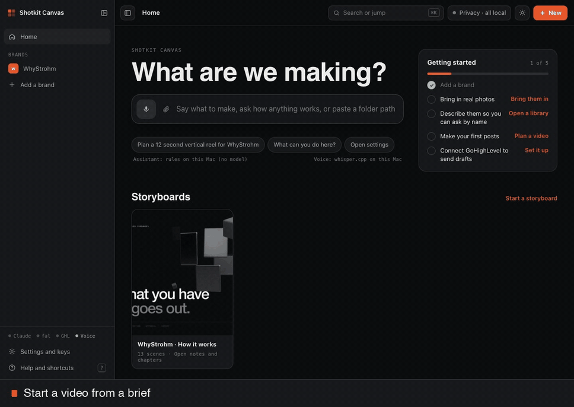
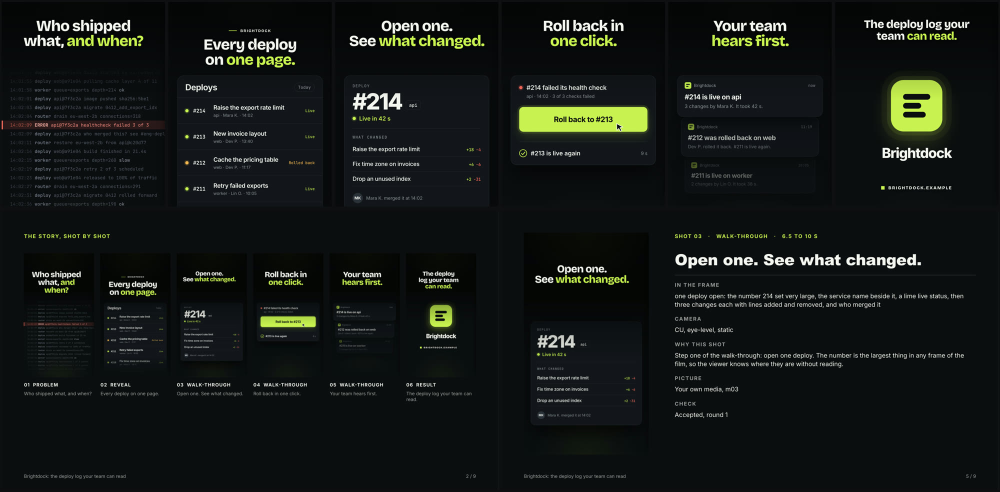

<h1 align="center">Shotkit</h1>

<p align="center"><strong>Plan the whole video before you generate a single frame.</strong><br>
Storyboard and review your video in a local workspace, or plan shots and check<br>
frames from Claude Code. Both use the same Shotkit run files.</p>

<p align="center"><strong>English</strong> · <a href="README.zh-CN.md">简体中文</a></p>

<p align="center">
  <a href="https://github.com/whystrohm/shotkit/actions/workflows/validate-skills.yml"></a>
  <a href="https://github.com/whystrohm/shotkit/releases/latest"></a>
  <a href="LICENSE"></a>
  <a href="https://github.com/whystrohm/shotkit/stargazers"></a>
</p>

<p align="center">
  <a href="#try-canvas"><strong>Get the Canvas preview</strong></a> ·
  <a href="#install">Install the Claude Code plugin</a> ·
  <a href="#connect-claude-in-canvas">Connect chat</a> ·
  <a href="#examples">Examples</a> ·
  <a href="#docs">Docs</a>
</p>



## Try Canvas

Canvas is a local macOS workspace. Python 3.10 or later opens Home, storyboards,
and the finished example films.

If Canvas assets are pending, use the [workspace walkthrough](docs/images/workspace-demo.gif)
or [install the Claude Code plugin](#install).

1. Under **Assets** for a published Canvas preview, download the
   `shotkit-canvas-*.zip` and the matching `.zip.sha256`. GitHub's **Source code**
   archives contain the Shotkit plugin and CLI. [GitHub Releases](https://github.com/whystrohm/shotkit/releases)
2. Put the archive and checksum in their own folder. From that folder, verify,
   extract, and open Canvas.

   ```sh
   shasum -a 256 -c shotkit-canvas-*.zip.sha256 &&
   unzip shotkit-canvas-*.zip &&
   cd shotkit-canvas &&
   ./start.sh --isolated --open --port 0
   ```

3. On Home, open **WhyStrohm · How it works**. Play the film, compare wide and
   feed at the same moment, and pin a note on a frame. Open **The flight of
   Apollo 11** to try chapter navigation on a longer board.

The preview includes the workspace source and example media. To play editable
cut previews, run `npm ci` and `npm run build` in the Canvas folder, then
restart it.

### Connect Claude in Canvas

1. Run `./start.sh --open` from the Canvas folder to use your regular profile.
2. In Canvas, open **Settings and keys → Claude**, paste an API key and select
   **Save and check**. Create the key in [Claude Console](https://platform.claude.com/settings/keys).
3. Return to **Home** and ask about your project. Canvas stores the key in macOS
   Keychain. Claude receives the request and relevant project context.
4. Choose **Add a brand** and enter a website. Canvas saves a brand lock with the
   colours, fonts and voice rules the site shows.
5. Ask in chat for a video, for example "Plan a 12 second wide film for
   WhyStrohm: research, production, approval". The planned storyboard opens
   from the chat. Attach your own stills and clips, then make an editable cut.

### Use Canvas from Codex

Start Canvas normally on port **4711** and sign in with `codex login`. Add the
Canvas MCP server using the absolute path to the extracted folder, then start a
new Codex session.

```sh
codex mcp add shotkit-canvas -- python3 "/path/to/shotkit-canvas/mcp.py"
```

Ask Codex to list the open storyboards. If Canvas uses another port, pass
`--env SHOTKIT_CANVAS_URL=http://127.0.0.1:PORT` before the `--`.
The workspace's Home chat uses Claude Console or local rules.

The local MCP tools read run keys with `board_state`. Use `storyboard_state`
to read one board, its current revision, shots and notes. To edit it, pass that
revision as `expected_board_revision` to `run_commands`. Undo uses the run,
latest undo entry and current revision. Canvas records those changes with
the `mcp` source label.

## Install

In Claude Code:

```
/plugin install shotkit --marketplace whystrohm/shotkit
```

Then type a brief:

```
/shotkit:shotkit 30-second launch video for our new app, 9:16
```

Shotkit plans the shots, writes the prompts and opens the portable board in your
browser. The checks create a private Python environment for their dependencies.

Three briefs to try:

```
/shotkit:shotkit 20-second launch video for our app, 9:16. Draw the product screens, do not generate them.
/shotkit:shotkit 30-second ad for https://example.com, 9:16, no voiceover
/shotkit:shotkit 60-second founder explainer, 16:9, with voiceover
```

Then ask for what you need next: "write the Kling prompts", "check the frames",
"export the stills", "export the deck".

<details>
<summary>Other ways to install</summary>

The one-line plugin install needs Claude Code 2.1.275 or later. On an older version, run
`/plugin marketplace add whystrohm/shotkit` and then `/plugin install shotkit@shotkit`.

Without the plugin system, use the installer:

```bash
git clone https://github.com/whystrohm/shotkit.git
cd shotkit && ./install.sh
```

Installed this way, the command is `/shotkit` in place of `/shotkit:shotkit`.

</details>

### Open a run in Canvas

With a local Canvas preview that supports workspace API 1, open your project
from the CLI. From the Shotkit checkout, use `tools/sk`. After running
`./install.sh`, use the installed copy below.

```bash
~/.claude/shotkit-tools/sk workspace "/path/to/project" \
  --runtime "/path/to/shotkit-canvas" --open
```

The project folder and its `output/` folder open the same run. You can set
`SHOTKIT_CANVAS_HOME` to your Canvas folder to skip `--runtime`. Use
`--rules-only` for local review without an AI connection or `--port 0` to
choose an available localhost port. Use `--isolated` to skip discovery of other
projects and saved keys. `sk doctor` reports whether the configured launcher
is usable.

Open the plugin's portable board with `sk board output/ --open`.

### Your brand

Point it at your site:

```
/shotkit:shotkit 30-second launch video for https://example.com, 9:16
```

Shotkit reads the site and writes the brand lock: the colours, the type and the voice.
Each value is marked with where it came from, and a guess is flagged for you to confirm.
A brand book PDF or screenshots work the same way. You do not fill in a table.

With no brand in the brief, a first run uses a neutral starter brand and says so.
Writing a lock by hand from `brand-packs/_template.md` is the manual route, for when you
want to set every value yourself. See [`brand-packs/README.md`](brand-packs/README.md).

## Examples

The Canvas preview includes the [WhyStrohm How It Works project](https://whystrohm.com/system)
shown in the animation.

Three finished runs. The first two pictures open a live board. The third is in this repo: `tools/sk board --example`.

| Media Tsunami · 16:9 | Roofing company · 16:9 | Software launch · 9:16 |
|---|---|---|
| [](https://whystrohm.com/shotkit/examples/whystrohm-media-tsunami/board.html) | [](https://whystrohm.com/shotkit/examples/kestrel-roofing/board.html) | [](examples/brightdock) |

## Why

An image or video generator makes one clip at a time. A 30-second video is eight shots
that have to agree: the same person, the same room, the same light, the same brand, and
text that fits the picture. Prompted one at a time, shot five does not match shot two,
the brand colour drifts, and nobody looks at a frame until it is in the edit.

Shotkit does the part that comes before generation:

- **Plans every shot** against a story framework: length, framing, motion and on-screen text.
- **Locks what must not change.** One character, place, light and grade for the whole
  video, and your brand's colours and type, pinned by hash.
- **Writes a prompt per shot** for ten image and video generators, each in that model's
  own format.
- **Checks every frame** against its shot and the brand, and says what to fix. Only that
  shot is redone.
- **Draws what a generator cannot.** A screen of your product, a number, a quote or a
  logo card is drawn in code from your brand. No model, and the same picture every time.
- **Uses your own footage first.** Point it at a folder of photos and clips. It looks at
  each one, places it, and marks only what is missing for a generator to fill.
- **Sets the type like the brand would.** The words that carry each line are marked in
  the brand's accent, the brand name is set as a lockup, and on a vertical video the
  type stays clear of the app's own buttons.
- **Puts it all on one board** that opens in your browser, with copy buttons for any model.
- **Hands you files to use.** Carousel stills with the text on them, a PowerPoint deck,
  a rough-cut video, and a shot list, subtitles and an edit decision list for the crew
  and the editor.

The portable board and checks run locally. Canvas runs on a localhost server.
When you ask Claude Code to plan or review, it receives the brief, brand
references and media it reads. Canvas Home chat sends the request and relevant
project context to Claude when you enable the Console connection. Generation
uses your fal.ai key and requires approval. [Security and data](SECURITY.md)


## The board

One page for the whole run. It is a single HTML file in your output folder, it opens
offline, and nothing is uploaded. Online, it loads the brand's typefaces from Google
Fonts. Offline, type falls back to your system fonts.

- **Every shot at once.** A contact sheet and a timeline with shots, on-screen text and
  voiceover on separate tracks.
- **Prompts with a copy button.** One tab per generator. Press `C` to copy the open one.
- **The critic's verdict on each frame**, with what is working, what is not and the fix.
  Earlier rounds stay one click away.
- **Copy for LLM.** The whole storyboard, one shot or the brand lock as Markdown, ready
  to paste into another model.
- **The next step, as a line to paste into Claude.**
- **Files checked against `run.json`.** A file that changed after the run is flagged.
- **Live mode.** `sk board output/ --serve` reloads as files change. Drop a frame on a
  shot and it is saved to the right folder under the right name. Drag the text on a shot
  to move it; it stays inside the safe zone and the new position is saved.
- **Safe zones.** One switch shows the parts of a vertical video an app covers.
- **A page for the client, before anything is shot.** `preview.html` is the same plan
  as a clean, brand-aware page. The board's **PDF** button opens it ready to print.
- **Export.** Carousel stills with the text on them, a PowerPoint deck, a rough-cut
  video, and the shoot and edit files, from one button. See [`docs/export.md`](docs/export.md).
- **Frames and clips, if you want them.** With your own fal.ai key, `sk generate` makes
  the stills and the video clips and files them. See
  [`docs/generate-with-fal.md`](docs/generate-with-fal.md).


See a finished run before you make one. Build the bundled example from a clone, then
export it:

```bash
tools/sk board --example
tools/sk export examples/brightdock
```



The stills, the deck and the rough cut are drawn by the board's own page, so they carry
the type you see on the board.

The demo at the top is 14 seconds. The plan, the check and the rough cut are the Media
Tsunami run. The boards after it are three more runs: Brightdock, whose screens are drawn
in code, Kestrel Roofing and Harbor Roast. The same cut is a silent MP4
at [`docs/images/demo.mp4`](docs/images/demo.mp4).

---

## What it does

You describe a video. Shotkit writes one folder:

```
output/
├── run.json                   # Run id + every input pinned by content hash
├── storyboard.md              # Human-readable, shot-by-shot
├── shots.json                 # Schema-validated, machine-readable
├── text-overlays.json         # On-screen text + timing
├── brand-lock.snapshot.md     # Frozen brand state at generation time
├── prompts/round-1/           # One file per generator: flux.txt, kling.txt and eight more
├── media/                     # Your own photos and clips, listed, if you start from them
├── design/                    # Cards for frames drawn in code, and the receipt, if you use them
├── frames/round-1/            # The frames: yours, or made with `sk generate`
├── clips/round-1/             # Video clips, one per shot, if you make them
├── board.html                 # The board. Where you work. Opens by itself.
├── critiques/round-1/         # One verdict per shot, hashing what it reviewed
├── approvals/                 # A person's yes, if you record one with `sk approve`
├── export/                    # Stills, a deck and a rough cut, if you make them with `sk export`
└── preview.html               # The page you send a client. Printable. Brand-aware.
```

Plain files an editor, an agency or a developer can act on. Shotkit has no server and no
account. Everything is filed by round and shot, so round 2 never overwrites round 1.

### Start from footage you already have

```
/shotkit:shotkit a 30-second video from the photos and clips in ~/Desktop/shoot, 9:16
```

Claude looks at every photo and clip, puts each one on the shot it fits, and marks what
is missing. A generator fills only the gaps, and a bridge clip can join two of your
shots that do not cut together. Or start a live board on an empty folder and drop the
files on the page. Your originals are never moved or changed.
See [Start from your own photos and clips](docs/own-media.md).

---

## The skills

| Skill | What it does |
|---|---|
| `shotkit` | One command. Runs the others in order and opens the board. Type `/shotkit:shotkit <brief>` |
| `brand-lock-extractor` | Brand assets (URL / PDF / screenshots) → validate-ready `brand-lock.md` |
| `storyboard-architect` | Brief → structured storyboard (`storyboard.md` + `shots.json`) |
| `visual-prompt-forge` | Shot data → model-specific prompts for 10 generators (6 stills, 4 motion) |
| `visual-asset-critic` | Generated image + intent → markdown critique + machine-readable `critique.json` |
| `storyboard-html-preview` | Storyboard files → single-file shareable HTML |

They work alone. They work better together, the critic writes a machine-readable verdict the prompt-forge can act on, so generate → critique → revise → re-critique runs as a closed loop. See [`docs/the-qa-loop.md`](docs/the-qa-loop.md). They work in **Claude Code**, **Claude.ai**, and the **Claude API**.

---

## Outputs

- **Portable board.** A timed plan, prompts, frame checks, and optional generated
  frames and clips. Export carousel stills, a deck, a rough cut and crew files.
  [Generation](docs/generate-with-fal.md) · [Export](docs/export.md)
- **Canvas preview.** Chapters, reorderable shots, frame notes, revision history,
  an editable cut, and a handoff with a timed clip list and optional source media.
  [Try Canvas](#try-canvas)

WhyStrohm also offers video production. [WhyStrohm](https://whystrohm.com)

### A person's approval

The critic's verdict is a model's review. When a person approves, write that down too:

```bash
~/.claude/shotkit-tools/sk approve output/ --by "Dana Reyes"                # the plan
~/.claude/shotkit-tools/sk approve output/ --by "Dana Reyes" --what frames  # the accepted frames
```

Each approval is a new file in `output/approvals/` that names what was approved, by hash.
The board and `sk validate` say when one no longer holds because something changed after
it. The name is whatever was typed, so this is a record and not a signature.

**Bring your own key.** For generation with the CLI, keep your fal.ai key in
your environment or a git-ignored `.env` file. The repo's checks scan for
committed secrets.

To hand the files to your own editor instead, `shots.json` and `text-overlays.json`
carry every shot, length and line of text. See
[`docs/connecting-to-generators.md`](docs/connecting-to-generators.md) and
[`docs/connecting-to-video-pipelines.md`](docs/connecting-to-video-pipelines.md).

---

## Docs

| | |
|---|---|
| [Quickstart](https://whystrohm.com/shotkit/docs/quickstart) | A first run, in six steps |
| [Start from your own photos and clips](docs/own-media.md) | Scan a folder, place each file, fill the gaps |
| [Frames and clips with fal.ai](docs/generate-with-fal.md) | Connect your key, pick a model |
| [Designed frames](docs/designed-frames.md) | Screens, numbers and quotes drawn in code from your brand |
| [Export](docs/export.md) | Carousel stills, a deck, a rough cut, and the shoot and edit files |
| [The check and revise loop](docs/the-qa-loop.md) | How a frame is sent back and fixed |
| [Brand locks](docs/brand-lock-anatomy.md) | What a brand lock holds, and how to make one |
| [The audit trail](docs/audit-trail-pattern.md) | What `run.json` pins, and how to prove it |
| [Background and reference](docs/background.md) | Why it exists, the method, brand packs, roadmap |
| [Changelog](CHANGELOG.md) | What changed in each release |

---

## Contributing

Pull requests are welcome: a generator adapter, a beat framework, a brand pack, or a fix
with a test. Run `tools/sk check` first. See [CONTRIBUTING.md](CONTRIBUTING.md) and
[SECURITY.md](SECURITY.md).

---

## License

Apache 2.0. See [LICENSE](LICENSE) and [NOTICE](NOTICE).

The Apache License 2.0 covers the code and documentation in this repository. It does not grant rights to the Shotkit name or the WhyStrohm name.

---

## Who built this

Yuri Strohm created and maintains Shotkit at WhyStrohm. OpenAI Codex and
Anthropic Claude assisted with implementation and review. The workspace
design went through an Astra review.

[WhyStrohm](https://whystrohm.com) · [Contact](mailto:hello@whystrohm.com)
