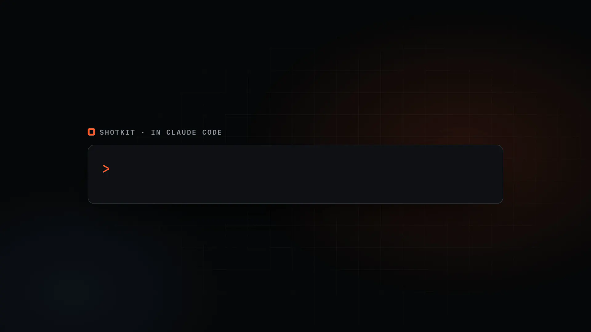
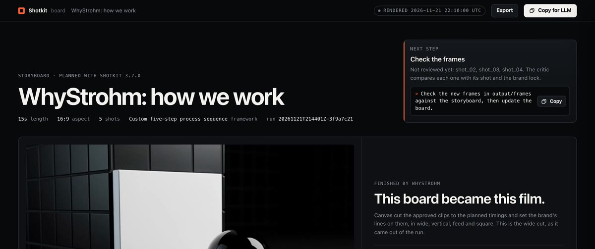

<p align="center"><a href="https://whystrohm.com/blog/shotkit-canvas-one-real-run"></a></p>

<h3 align="center">Ship on-brand video at scale.</h3>

<p align="center">Plan every shot on a board, check every frame, render every size.<br>
Bring your own footage or use AI where it helps. Every price waits for your yes.<br>
It runs on your Mac, with Claude Code or Codex, and your own keys.</p>

<p align="center"><strong>English</strong> · <a href="README.zh-CN.md">简体中文</a></p>

<p align="center">
  <a href="https://github.com/whystrohm/shotkit/actions/workflows/validate-skills.yml"></a>
  <a href="https://github.com/whystrohm/shotkit/releases"></a>
  <a href="LICENSE"></a>
  <a href="https://github.com/whystrohm/shotkit"></a>
</p>

<p align="center">
  <a href="#try-canvas"><strong>Try Canvas</strong></a> ·
  <a href="https://whystrohm.com/blog/shotkit-canvas-one-real-run">Watch a real run</a> ·
  <a href="https://whystrohm.com/shotkit/examples/whystrohm-how-we-work/board.html">Open its board</a> ·
  <a href="#install">Claude Code</a> ·
  <a href="#use-canvas-from-codex">Codex</a>
</p>

<p align="center"><strong>New in 3.7: Shotkit Canvas.</strong> Every clip plays on the board, shots move and trim,<br>
and one cut comes out in every size. Free and open source. <a href="https://github.com/whystrohm/shotkit/releases">Get it</a></p>

## What it does

Making one clip is easy now. Shipping fifty that look like one brand is not. Shotkit gives
that work a board: plan it, leave notes, break it, make it better, and render the version you
approve. It still takes your taste.

- **Keeps it on brand.** Paste your website. Shotkit saves your colours, type, voice and
  never-rules, and plans and checks every shot against them.
- **Organizes your own footage.** Drop in photos and clips, or a long recording with its
  transcript. Shotkit places them on shots and chapters and shows what is missing.
- **Uses AI for concepts and gaps.** Generate frames and clips to test an idea or fill a
  shot you cannot film. Not every generation is good, so a critic checks each one, only the
  misses are redone, and nothing runs until you approve the price.
- **Lets you see and cut.** Every clip plays on the board. Move shots, trim clips, change
  the lines and cut the video in 16:9, 9:16, 4:5 and 1:1.
- **Hands it off.** Render the cut, or export stills, a deck, a rough cut and an edit list
  for your editor.

## How it works

1. **Add your brand** from its website.
2. **Say what you want**, or bring your footage. Claude plans the shots on a board.
3. **Review the plan.** Move cards, change lines. No media has been made yet.
4. **Approve the price** of any frames or clips. A critic checks each one and sends the
   misses back.
5. **Cut every size.** Trim, reorder and preview, then render or hand off.

Our run for WhyStrohm: five shots, three sent back and remade, four sizes, about ten minutes
from brief to clips and $2.34 of generation at fal's quoted prices.
[Watch the 55-second film](https://whystrohm.com/blog/shotkit-canvas-one-real-run).

## Long recordings

Start a storyboard from a timecoded transcript (an SRT file) and add the MP4 recording.
Canvas splits it into chapters and shots at the timecodes, plays each piece, and cuts any
chapter straight from the recording. You can also start from a script, one shot per line.

## Try Canvas

Canvas is a preview for macOS. It needs Python 3.10 or later.

1. From [Releases](https://github.com/whystrohm/shotkit/releases), download
   `shotkit-canvas-*.zip` and the matching `.zip.sha256` into their own folder.
2. Verify, extract and open it:

   ```sh
   shasum -a 256 -c shotkit-canvas-*.zip.sha256 &&
   unzip shotkit-canvas-*.zip &&
   cd shotkit-canvas &&
   ./start.sh --isolated --open --port 0
   ```

3. Open the bundled example **WhyStrohm · How it works** and play it.

To preview and render cuts, install Node.js and run `npm ci` and `npm run build` once in the
Canvas folder.

### Connect Claude in Canvas

Run `./start.sh --open`, then paste a key from
[Claude Console](https://platform.claude.com/settings/keys) in **Settings and keys → Claude**.
Now you can add brands, plan videos and chat. The key stays in the macOS Keychain.

### Make frames and clips from Canvas

Generation also needs Claude Code signed in, a clone of this repo and a
[fal.ai](https://fal.ai) key saved in **Settings and keys**. Start Canvas this way and plan
the video in this mode:

```sh
SHOTKIT_HOME=/path/to/shotkit SHOTKIT_CANVAS_DATA="$HOME/.shotkit/canvas" python3 serve.py --open
```

Claude Code writes the prompts, runs the critic and writes revisions. Shotkit's tools price
and make the frames and clips. Every quote waits for your approval.

### Use Canvas from Codex

Start Canvas on port **4711**, sign in with `codex login` and add the Canvas MCP server:

```sh
codex mcp add shotkit-canvas -- python3 "/path/to/shotkit-canvas/mcp.py"
```

Codex can then list boards, read shots and notes, and make edits you can undo. For another
port, pass `--env SHOTKIT_CANVAS_URL=http://127.0.0.1:PORT` before the `--`.

### Install

In Claude Code:

```
/plugin install shotkit --marketplace whystrohm/shotkit
/shotkit:shotkit 30-second launch video for https://example.com, 9:16
```

Then ask for the next step in plain words: "check the frames", "export the stills".

<details>
<summary>More setup</summary>

**Older Claude Code** (before 2.1.275): `/plugin marketplace add whystrohm/shotkit`, then
`/plugin install shotkit@shotkit`. **Without plugins:** clone this repo and run
`./install.sh`; the command is then `/shotkit`.

**Open a run in Canvas.** `sk` is in the plugin's `tools/` folder, at
`~/.claude/shotkit-tools/sk` after `./install.sh`, and at `tools/sk` in a clone.

```bash
sk workspace "/path/to/project" --runtime "/path/to/shotkit-canvas" --open
```

`sk doctor` checks the setup. `--rules-only` reviews without AI, `--port 0` picks a free port.

**Your brand by hand.** Start from `brand-packs/_template.md`. See
[`brand-packs/README.md`](brand-packs/README.md) and
[a worked example](skills/brand-lock-extractor/examples/brand-lock.md) based on whystrohm.com.

**Codex tools.** `board_state` lists runs, `storyboard_state` reads one board with its
revision, and `run_commands` edits it when you pass that revision as `expected_board_revision`.

</details>

## What you get

| | |
|---|---|
| **The board** | Every shot, prompt, frame, verdict and clip on one page. It opens offline. |
| **Your files, organized** | Frames and clips filed by round and shot. Round 2 never overwrites round 1. |
| **Cuts** | Editable cuts in every size, with your lines in your type. |
| **Exports** | Carousel stills, a PowerPoint deck, a rough-cut MP4, a shot list, subtitles and an edit list. |
| **A client page** | The plan as a clean page you can send or print before anything is made. |
| **A record** | Every input pinned by hash. Approvals and fal request IDs saved with the run. |

Everything stays in a folder on your computer. What goes out: the pages Add a brand reads,
your requests to Claude, price checks and the jobs you approve on fal, Google Fonts when a
board is online, and anything you choose to send to GoHighLevel. [Security and data](SECURITY.md)

## Examples

Two real WhyStrohm runs. Each picture opens the live board.

| How we work · made in Canvas · 16:9 | Media Tsunami · 16:9 |
|---|---|
| [](https://whystrohm.com/shotkit/examples/whystrohm-how-we-work/board.html) | [](https://whystrohm.com/shotkit/examples/whystrohm-media-tsunami/board.html) |

<details>
<summary>Under the hood</summary>

**The skills**

| Skill | What it does |
|---|---|
| `shotkit` | Runs the others in order and opens the board |
| `brand-lock-extractor` | Website, PDF or screenshots → `brand-lock.md` |
| `storyboard-architect` | Brief → `storyboard.md` and `shots.json` |
| `visual-prompt-forge` | Shots → prompts for 10 generators |
| `visual-asset-critic` | Frame and intent → a verdict and `critique.json` |
| `storyboard-html-preview` | Storyboard → one shareable page |

**The run folder**

```
output/
├── run.json             # every input pinned by hash
├── storyboard.md        # shot by shot, for people
├── shots.json           # the same, for tools
├── brand-lock.snapshot.md
├── prompts/round-1/     # one file per generator
├── frames/round-1/      # yours or generated
├── clips/round-1/
├── critiques/round-1/   # one verdict per shot
├── approvals/           # a person's yes, from `sk approve`
├── export/              # stills, deck, rough cut
├── board.html
└── preview.html         # the client page
```

**A person's approval.** `sk approve output/ --by "Your Name" --what frames` records who
approved what, by hash. The board says when an approval no longer holds.

**Offline example.** From a clone, `tools/sk board --example` builds the bundled Brightdock
board, a fictional software launch.

</details>

## Docs

[Quickstart](https://whystrohm.com/shotkit/docs/quickstart) ·
[Your own photos and clips](docs/own-media.md) ·
[Frames and clips with fal.ai](docs/generate-with-fal.md) ·
[Designed frames](docs/designed-frames.md) ·
[Export](docs/export.md) ·
[The check and revise loop](docs/the-qa-loop.md) ·
[Brand locks](docs/brand-lock-anatomy.md) ·
[The audit trail](docs/audit-trail-pattern.md) ·
[Connecting generators](docs/connecting-to-generators.md) ·
[Changelog](CHANGELOG.md)

## Contributing, license and who built this

Pull requests are welcome: run `tools/sk check` first. See [CONTRIBUTING.md](CONTRIBUTING.md)
and [SECURITY.md](SECURITY.md). Apache 2.0, see [LICENSE](LICENSE) and [NOTICE](NOTICE); the
license does not grant rights to the Shotkit or WhyStrohm names.

Yuri Strohm made Shotkit at [WhyStrohm](https://whystrohm.com). OpenAI Codex and Anthropic
Claude helped with the code and review. Shotkit plans, checks and cuts; if you want the video
finished, edited and posted every month, [that is what WhyStrohm does](https://whystrohm.com/apply).
