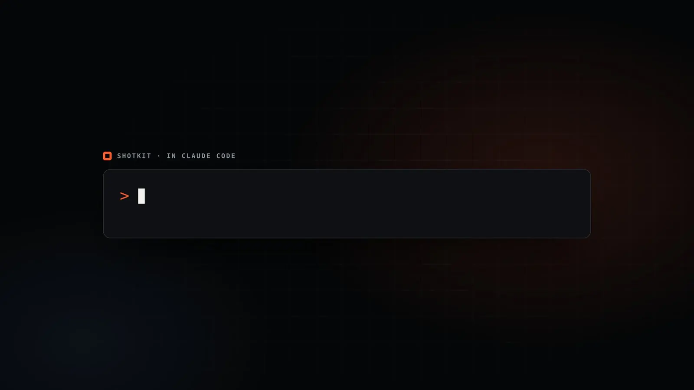
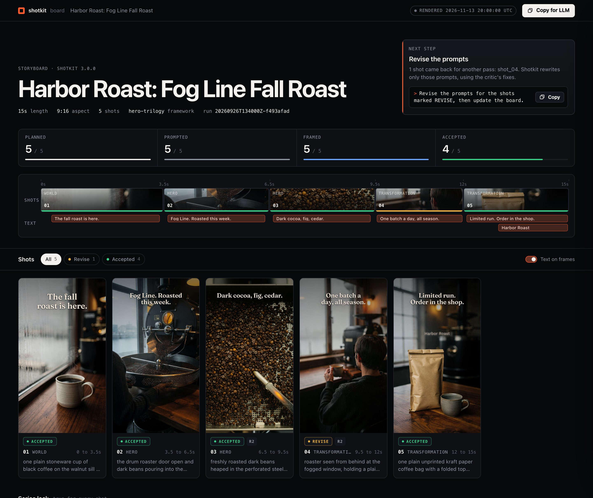
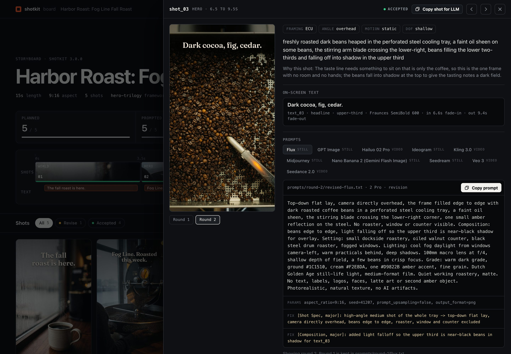

<h1 align="center">Shotkit</h1>

<p align="center"><strong>Plan a video in Claude Code.</strong><br>
One line of brief becomes a board with every shot planned, prompted and checked.</p>

<p align="center">
  <a href="https://github.com/whystrohm/shotkit/actions/workflows/validate-skills.yml"></a>
  <a href="https://github.com/whystrohm/shotkit/releases/latest"></a>
  <a href="LICENSE"></a>
  <a href="https://github.com/whystrohm/shotkit/stargazers"></a>
</p>

<p align="center">
  <a href="#install">Install</a> ·
  <a href="#the-board">The board</a> ·
  <a href="docs/generate-with-fal.md">Frames and clips</a> ·
  <a href="https://whystrohm.com/shotkit/docs/quickstart">Quickstart</a> ·
  <a href="https://whystrohm.com/shotkit/examples/harbor-roast/board.html">A live board</a>
</p>



Six Claude skills and a set of small tools, built by [WhyStrohm](https://whystrohm.com).
Free and open source under Apache 2.0. Nothing ships with a key.

## Install

```bash
git clone https://github.com/whystrohm/shotkit.git
cd shotkit && ./install.sh
```

Restart Claude Code and type a brief:

```
/shotkit 30-second launch video for Harbor Roast, 9:16
```

Shotkit plans the shots, writes the prompts and opens the board in your browser. There is
nothing else to set up. The installer makes a private Python environment for the
validators, so `pip` and your system Python are left alone.



## The board

One page for the whole run. It is a single HTML file in your output folder, it works
offline, and nothing is uploaded.

- **Every shot at once.** A contact sheet and a timeline with shots, on-screen text and
  voiceover on separate tracks.
- **Prompts with a copy button.** One tab per generator. Press `C` to copy the open one.
- **The critic's verdict on each frame**, with what is working, what is not and the fix.
  Earlier rounds stay one click away.
- **Copy for LLM.** The whole storyboard, one shot or the brand lock as Markdown, ready
  to paste into another model.
- **The next step, as a line to paste into Claude.**
- **Files checked against `run.json`.** A file that changed after the run is flagged.
- **Live mode.** `sk board output/ --serve` reloads as files change. Drop a frame on a
  shot and it is saved to the right folder under the right name.
- **Frames and clips, if you want them.** With your own fal.ai key, `sk generate` makes
  the stills and the video clips and files them. See
  [`docs/generate-with-fal.md`](docs/generate-with-fal.md).



See a finished run before you make one:

```bash
~/.claude/shotkit-tools/sk board --example
```

The loop is the live board replaying one real Shotkit run in stages: the brief, the plan,
the prompts, the frames, the critic's verdicts, then a second round for the shots that came
back. The frames are the ones that run produced. A silent MP4 of the same loop is at
[`docs/images/demo.mp4`](docs/images/demo.mp4).

---

## What it does

You describe a video. Shotkit writes one folder:

```
output/
├── run.json                   # Run id + every input pinned by content hash
├── storyboard.md              # Human-readable, shot-by-shot
├── shots.json                 # Schema-validated, machine-readable
├── text-overlays.json         # On-screen text + timing
├── brand-lock.snapshot.md     # Frozen brand state at generation time
├── prompts/round-1/           # One file per generator: flux.txt, kling.txt and eight more
├── frames/round-1/            # The frames: yours, or made with `sk generate`
├── clips/round-1/             # Video clips, one per shot, if you make them
├── board.html                 # The board. Where you work. Opens by itself.
├── critiques/round-1/         # One verdict per shot, hashing what it reviewed
└── preview.html               # The page you send a client. Printable. Brand-aware.
```

Plain files an editor, an agency or a developer can act on. Nothing is uploaded and there is
no account. Everything is filed by round and shot, so round 2 never overwrites round 1.

---

## The skills

| Skill | What it does |
|---|---|
| `shotkit` | One command. Runs the others in order and opens the board. Type `/shotkit <brief>` |
| `brand-lock-extractor` | Brand assets (URL / PDF / screenshots) → validate-ready `brand-lock.md` |
| `storyboard-architect` | Brief → structured storyboard (`storyboard.md` + `shots.json`) |
| `visual-prompt-forge` | Shot data → model-specific prompts for 10 generators (6 stills, 4 motion) |
| `visual-asset-critic` | Generated image + intent → markdown critique + machine-readable `critique.json` |
| `storyboard-html-preview` | Storyboard files → single-file shareable HTML |

They work alone. They work better together, the critic writes a machine-readable verdict the prompt-forge can act on, so generate → critique → revise → re-critique runs as a closed loop. See [`docs/the-qa-loop.md`](docs/the-qa-loop.md). They work in **Claude Code**, **Claude.ai**, and the **Claude API**.

---

## Concepts fast. Finished video is a service.

Shotkit is for getting from an idea to something you can look at, quickly and many times
over. A marketing team can put ten concepts on ten boards in an afternoon, each with a
shot plan, on-screen copy, frames and short clips, all in the brand.

What it gives you is raw material and a plan, not a finished video:

- **In Shotkit.** The plan, the prompts, the checks, the board. With your own
  [fal.ai](https://fal.ai) key, the frames and clips too:
  [`docs/generate-with-fal.md`](docs/generate-with-fal.md).
- **Not in Shotkit.** The edit. Cutting the shots to time, setting the type, grading,
  sound, every size a campaign needs, and posting.

The second list is what WhyStrohm does as a service. Every video is built from the same
plan, so the hundredth one matches the first. Ask about the full system at
[hello@whystrohm.com](mailto:hello@whystrohm.com) or [whystrohm.com](https://whystrohm.com).

**Bring your own key.** Shotkit ships with no keys and calls nothing until you connect
your own fal.ai key. That key stays in your environment or a `.env` file git ignores.
The repo's checks fail if a key is ever committed.

To hand the files to your own editor instead, `shots.json` and `text-overlays.json`
carry every shot, length and line of text. See
[`docs/connecting-to-generators.md`](docs/connecting-to-generators.md) and
[`docs/connecting-to-video-pipelines.md`](docs/connecting-to-video-pipelines.md).

---

## Docs

| | |
|---|---|
| [Quickstart](https://whystrohm.com/shotkit/docs/quickstart) | A first run, in six steps |
| [Frames and clips with fal.ai](docs/generate-with-fal.md) | Connect your key, pick a model |
| [The check and revise loop](docs/the-qa-loop.md) | How a frame is sent back and fixed |
| [Brand locks](docs/brand-lock-anatomy.md) | What a brand lock holds, and how to make one |
| [The audit trail](docs/audit-trail-pattern.md) | What `run.json` pins, and how to prove it |
| [Background and reference](docs/background.md) | Why it exists, the method, brand packs, roadmap |
| [Changelog](CHANGELOG.md) | What changed in each release |

---

## Contributing

Pull requests are welcome: a generator adapter, a beat framework, a brand pack, or a fix
with a test. Run `tools/sk check` first. See [CONTRIBUTING.md](CONTRIBUTING.md) and
[SECURITY.md](SECURITY.md).

---

## License

Apache 2.0. See [LICENSE](LICENSE) and [NOTICE](NOTICE).

The Apache License 2.0 covers the code and documentation in this repository. It does not grant rights to the Shotkit name or the WhyStrohm name.

---

## Who built this

[WhyStrohm](https://whystrohm.com). For the finished video, write to
[hello@whystrohm.com](mailto:hello@whystrohm.com).
