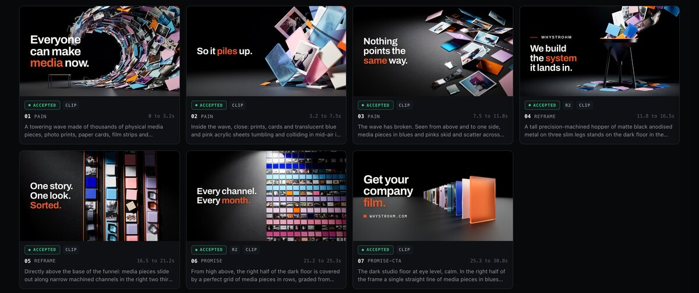
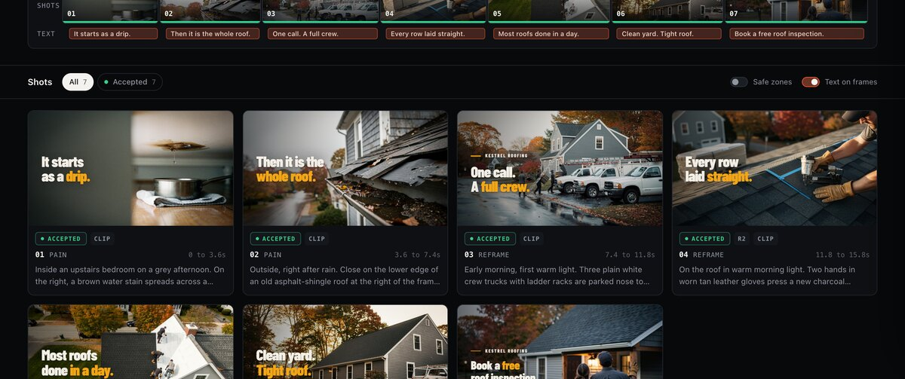
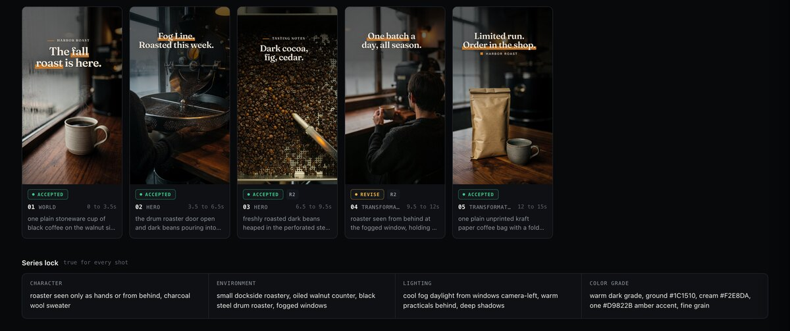
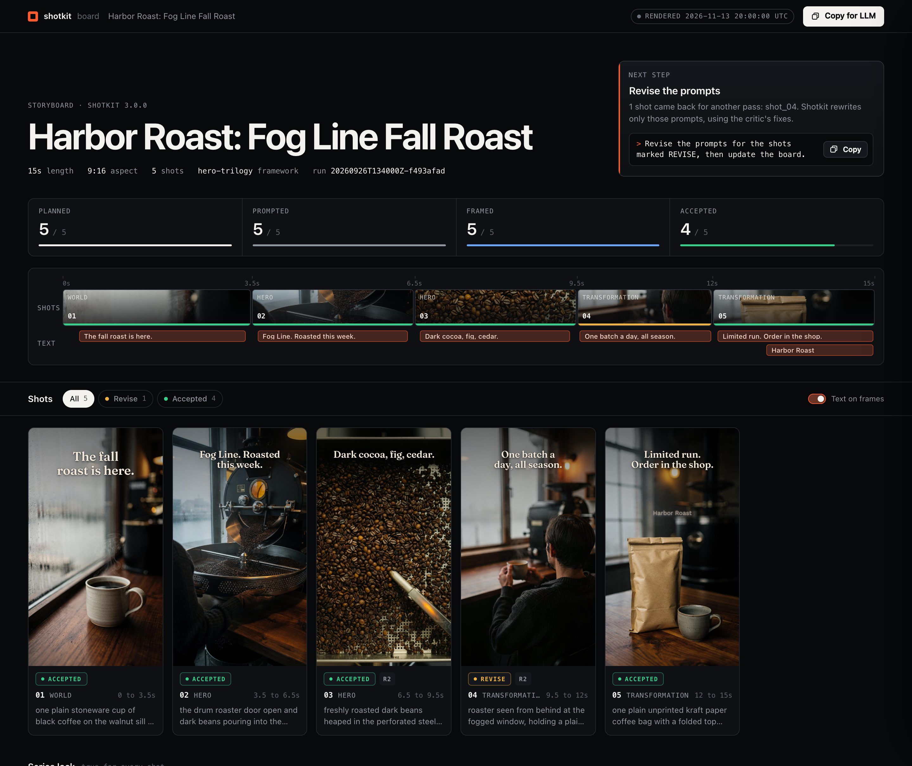
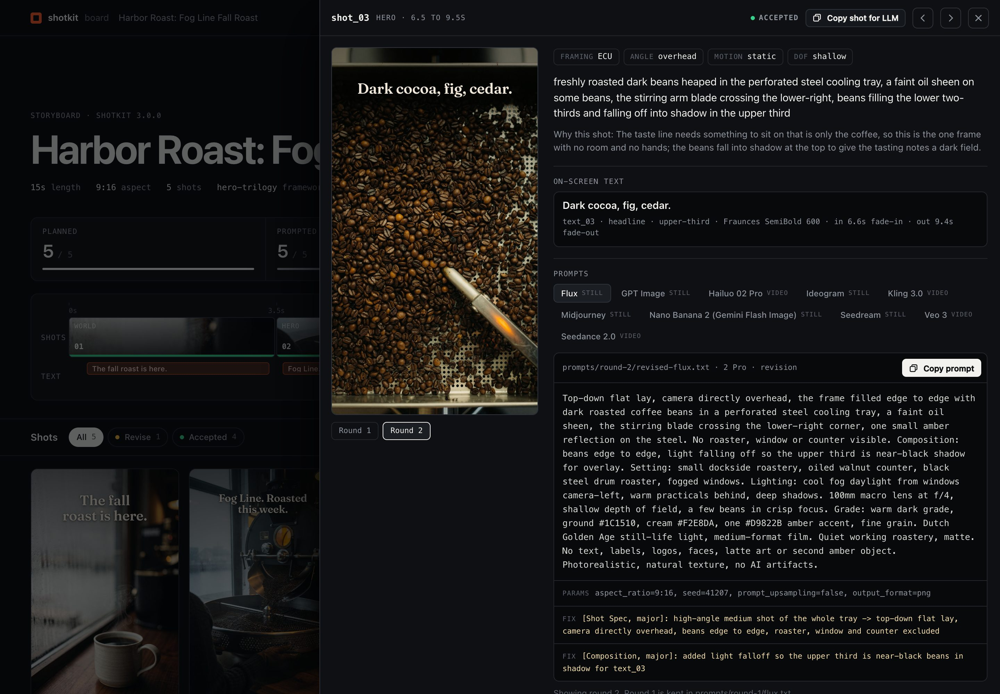

<h1 align="center">Shotkit</h1>

<p align="center"><strong>Plan the whole video before you generate a single frame.</strong><br>
An AI storyboard skill for Claude Code. One line of brief, or a folder of your own footage,<br>
becomes a board with every shot planned, prompted and checked.</p>

<p align="center"><strong>English</strong> · <a href="README.zh-CN.md">简体中文</a></p>

<p align="center">
  <a href="https://github.com/whystrohm/shotkit/actions/workflows/validate-skills.yml"></a>
  <a href="https://github.com/whystrohm/shotkit/releases/latest"></a>
  <a href="LICENSE"></a>
  <a href="https://github.com/whystrohm/shotkit/stargazers"></a>
</p>

<p align="center">
  <a href="#install">Install</a> ·
  <a href="#why">Why</a> ·
  <a href="#the-board">The board</a> ·
  <a href="docs/own-media.md">Your own footage</a> ·
  <a href="docs/generate-with-fal.md">Frames and clips</a> ·
  <a href="https://whystrohm.com/shotkit/docs/quickstart">Quickstart</a> ·
  <a href="https://whystrohm.com/shotkit/examples/whystrohm-media-tsunami/board.html">A live board</a>
</p>


Three finished runs. Each picture opens the live board.

| Media Tsunami · 16:9 | Roofing company · 16:9 | Coffee roaster · 9:16 |
|---|---|---|
| [](https://whystrohm.com/shotkit/examples/whystrohm-media-tsunami/board.html) | [](https://whystrohm.com/shotkit/examples/kestrel-roofing/board.html) | [](https://whystrohm.com/shotkit/examples/harbor-roast/board.html) |

Six Claude skills and a set of small tools, built by [WhyStrohm](https://whystrohm.com).
Free and open source under Apache 2.0. Nothing ships with a key.

## Why

An image or video generator makes one clip at a time. A 30-second video is eight shots
that have to agree: the same person, the same room, the same light, the same brand, and
text that fits the picture. Prompted one at a time, shot five does not match shot two,
the brand colour drifts, and nobody looks at a frame until it is in the edit.

Shotkit does the part that comes before generation:

- **Plans every shot** against a story framework: length, framing, motion and on-screen text.
- **Locks what must not change.** One character, place, light and grade for the whole
  video, and your brand's colours and type, pinned by hash.
- **Writes a prompt per shot** for ten image and video generators, each in that model's
  own format.
- **Checks every frame** against its shot and the brand, and says what to fix. Only that
  shot is redone.
- **Uses your own footage first.** Point it at a folder of photos and clips. It looks at
  each one, places it, and marks only what is missing for a generator to fill.
- **Sets the type like the brand would.** The words that carry each line are marked in
  the brand's accent, the brand name is set as a lockup, and on a vertical video the
  type stays clear of the app's own buttons.
- **Puts it all on one board** that opens in your browser, with copy buttons for any model.

**It runs on your computer.** The plan, the board, the checks and your footage never
leave it. The only thing that goes out is a generation request, and only when you ask
for one with your own key.

Shotkit plans the shots, and with your own key it can make the frames and clips. It does
not cut the film.

## Install

In Claude Code:

```
/plugin install shotkit --marketplace whystrohm/shotkit
```

Then type a brief:

```
/shotkit:shotkit 30-second launch video for Harbor Roast, 9:16
```

Shotkit plans the shots, writes the prompts and opens the board in your browser. There
is nothing else to set up. The checks make their own private Python environment, so
`pip` and your system Python are left alone.

<details>
<summary>Other ways to install</summary>

The one-line plugin install needs Claude Code 2.1.275 or later. On an older version, run
`/plugin marketplace add whystrohm/shotkit` and then `/plugin install shotkit@shotkit`.

Without the plugin system, use the installer:

```bash
git clone https://github.com/whystrohm/shotkit.git
cd shotkit && ./install.sh
```

Installed this way, the command is `/shotkit` in place of `/shotkit:shotkit`.

</details>

### Your brand

Point it at your site:

```
/shotkit:shotkit 30-second launch video for https://example.com, 9:16
```

Shotkit reads the site and writes the brand lock: the colours, the type and the voice.
Each value is marked with where it came from, and a guess is flagged for you to confirm.
A brand book PDF or screenshots work the same way. You do not fill in a table.

With no brand in the brief, a first run uses a neutral starter brand and says so.
Writing a lock by hand from `brand-packs/_template.md` is the manual route, for when you
want to set every value yourself. See [`brand-packs/README.md`](brand-packs/README.md).



## The board

One page for the whole run. It is a single HTML file in your output folder, it opens
offline, and nothing is uploaded. Online, it loads the brand's typefaces from Google
Fonts. Offline, type falls back to your system fonts.

- **Every shot at once.** A contact sheet and a timeline with shots, on-screen text and
  voiceover on separate tracks.
- **Prompts with a copy button.** One tab per generator. Press `C` to copy the open one.
- **The critic's verdict on each frame**, with what is working, what is not and the fix.
  Earlier rounds stay one click away.
- **Copy for LLM.** The whole storyboard, one shot or the brand lock as Markdown, ready
  to paste into another model.
- **The next step, as a line to paste into Claude.**
- **Files checked against `run.json`.** A file that changed after the run is flagged.
- **Live mode.** `sk board output/ --serve` reloads as files change. Drop a frame on a
  shot and it is saved to the right folder under the right name. Drag the text on a shot
  to move it; it stays inside the safe zone and the new position is saved.
- **Safe zones.** One switch shows the parts of a vertical video an app covers.
- **A page for the client, before anything is shot.** `preview.html` is the same plan
  as a clean, brand-aware page. The board's **PDF** button opens it ready to print.
- **Frames and clips, if you want them.** With your own fal.ai key, `sk generate` makes
  the stills and the video clips and files them. See
  [`docs/generate-with-fal.md`](docs/generate-with-fal.md).



See a finished run before you make one. Open [a live board](https://whystrohm.com/shotkit/examples/harbor-roast/board.html),
or build the bundled example from a clone:

```bash
tools/sk board --example
```

The demo at the top is a 10-second cut of the live board replaying one real Shotkit run:
the Media Tsunami film, planned in seven shots, checked, then the film that plan became.
The full 37-second version, with two frames sent back and redone, is a silent MP4 at
[`docs/images/demo.mp4`](docs/images/demo.mp4).

---

## What it does

You describe a video. Shotkit writes one folder:

```
output/
├── run.json                   # Run id + every input pinned by content hash
├── storyboard.md              # Human-readable, shot-by-shot
├── shots.json                 # Schema-validated, machine-readable
├── text-overlays.json         # On-screen text + timing
├── brand-lock.snapshot.md     # Frozen brand state at generation time
├── prompts/round-1/           # One file per generator: flux.txt, kling.txt and eight more
├── media/                     # Your own photos and clips, listed, if you start from them
├── frames/round-1/            # The frames: yours, or made with `sk generate`
├── clips/round-1/             # Video clips, one per shot, if you make them
├── board.html                 # The board. Where you work. Opens by itself.
├── critiques/round-1/         # One verdict per shot, hashing what it reviewed
└── preview.html               # The page you send a client. Printable. Brand-aware.
```

Plain files an editor, an agency or a developer can act on. Nothing is uploaded and there is
no account. Everything is filed by round and shot, so round 2 never overwrites round 1.

### Start from footage you already have

```
/shotkit:shotkit a 30-second video from the photos and clips in ~/Desktop/shoot, 9:16
```

Claude looks at every photo and clip, puts each one on the shot it fits, and marks what
is missing. A generator fills only the gaps, and a bridge clip can join two of your
shots that do not cut together. Or start a live board on an empty folder and drop the
files on the page. Your originals are never moved or changed.
See [Start from your own photos and clips](docs/own-media.md).

---

## The skills

| Skill | What it does |
|---|---|
| `shotkit` | One command. Runs the others in order and opens the board. Type `/shotkit:shotkit <brief>` |
| `brand-lock-extractor` | Brand assets (URL / PDF / screenshots) → validate-ready `brand-lock.md` |
| `storyboard-architect` | Brief → structured storyboard (`storyboard.md` + `shots.json`) |
| `visual-prompt-forge` | Shot data → model-specific prompts for 10 generators (6 stills, 4 motion) |
| `visual-asset-critic` | Generated image + intent → markdown critique + machine-readable `critique.json` |
| `storyboard-html-preview` | Storyboard files → single-file shareable HTML |

They work alone. They work better together, the critic writes a machine-readable verdict the prompt-forge can act on, so generate → critique → revise → re-critique runs as a closed loop. See [`docs/the-qa-loop.md`](docs/the-qa-loop.md). They work in **Claude Code**, **Claude.ai**, and the **Claude API**.

---

## Concepts fast. Finished video is a service.

Shotkit is for getting from an idea to something you can look at, quickly and many times
over. A marketing team can put ten concepts on ten boards in an afternoon, each with a
shot plan, on-screen copy, frames and short clips, all in the brand.

What it gives you is raw material and a plan, not a finished video:

- **In Shotkit.** The plan, the prompts, the checks, the board. With your own
  [fal.ai](https://fal.ai) key, the frames and clips too:
  [`docs/generate-with-fal.md`](docs/generate-with-fal.md).
- **Not in Shotkit.** The edit. Cutting the shots to time, setting the type, grading,
  sound, every size a campaign needs, and posting.

The second list is what WhyStrohm does as a service. Every video is built from the same
plan, so the hundredth one matches the first. Ask about the full system at
[hello@whystrohm.com](mailto:hello@whystrohm.com) or [whystrohm.com](https://whystrohm.com).

**Bring your own key.** Shotkit ships with no keys and calls nothing until you connect
your own fal.ai key. That key stays in your environment or a `.env` file git ignores.
The repo's checks fail if a key is ever committed.

To hand the files to your own editor instead, `shots.json` and `text-overlays.json`
carry every shot, length and line of text. See
[`docs/connecting-to-generators.md`](docs/connecting-to-generators.md) and
[`docs/connecting-to-video-pipelines.md`](docs/connecting-to-video-pipelines.md).

---

## Docs

| | |
|---|---|
| [Quickstart](https://whystrohm.com/shotkit/docs/quickstart) | A first run, in six steps |
| [Start from your own photos and clips](docs/own-media.md) | Scan a folder, place each file, fill the gaps |
| [Frames and clips with fal.ai](docs/generate-with-fal.md) | Connect your key, pick a model |
| [The check and revise loop](docs/the-qa-loop.md) | How a frame is sent back and fixed |
| [Brand locks](docs/brand-lock-anatomy.md) | What a brand lock holds, and how to make one |
| [The audit trail](docs/audit-trail-pattern.md) | What `run.json` pins, and how to prove it |
| [Background and reference](docs/background.md) | Why it exists, the method, brand packs, roadmap |
| [Changelog](CHANGELOG.md) | What changed in each release |

---

## Contributing

Pull requests are welcome: a generator adapter, a beat framework, a brand pack, or a fix
with a test. Run `tools/sk check` first. See [CONTRIBUTING.md](CONTRIBUTING.md) and
[SECURITY.md](SECURITY.md).

---

## License

Apache 2.0. See [LICENSE](LICENSE) and [NOTICE](NOTICE).

The Apache License 2.0 covers the code and documentation in this repository. It does not grant rights to the Shotkit name or the WhyStrohm name.

---

## Who built this

[WhyStrohm](https://whystrohm.com). For the finished video, write to
[hello@whystrohm.com](mailto:hello@whystrohm.com).
