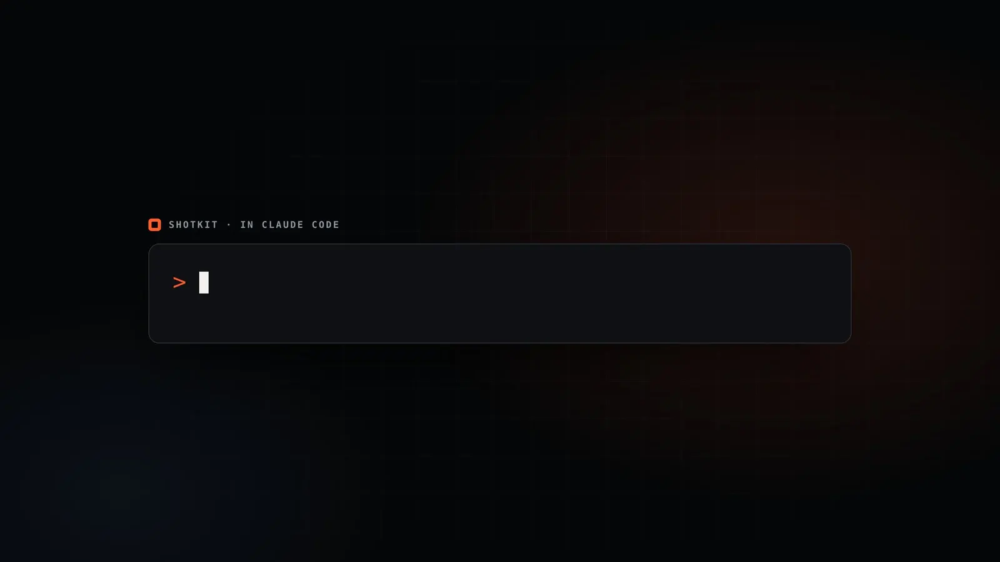
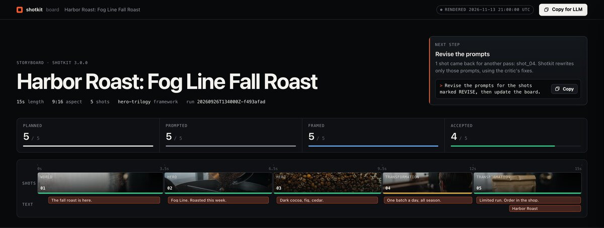
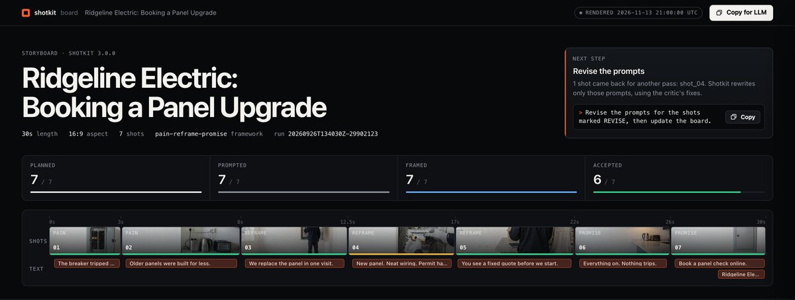
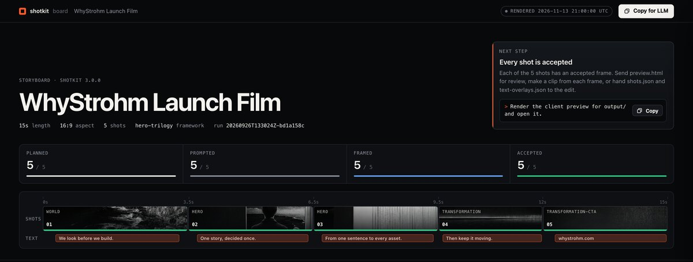

<h1 align="center">Shotkit</h1>

<p align="center"><strong>先把整支视频规划好，再去生成第一帧。</strong><br>
Claude Code 的 AI 分镜技能包。一句需求，或者一个装着你自己素材的文件夹，<br>
变成一块看板：每个镜头都已规划、写好提示词、并经过检查。</p>

<p align="center"><a href="README.md">English</a> · <strong>简体中文</strong></p>



三个已完成的案例，点击图片打开在线看板。

| 咖啡烘焙 · 9:16 | 电工服务 · 16:9 | 工作室发布 · 16:9 |
|---|---|---|
| [](https://whystrohm.com/shotkit/examples/harbor-roast/board.html) | [](https://whystrohm.com/shotkit/examples/ridgeline-electric/board.html) | [](https://whystrohm.com/shotkit/examples/whystrohm-launch/board.html) |

六个 Claude 技能加一组小工具，由 [WhyStrohm](https://whystrohm.com) 开发。
Apache 2.0 开源，免费。仓库里不带任何密钥。

## 为什么需要它

图像和视频生成模型一次只出一个片段。一支 30 秒的视频是八个必须互相对得上的镜头：
同一个人、同一个场景、同一种光线、同一个品牌，文字还要放得进画面。
一个一个地写提示词，第五个镜头就和第二个对不上，品牌色会跑偏，
而且直到剪辑时才有人认真看每一帧。

Shotkit 做的是生成之前的那一步：

- **规划每个镜头**：时长、景别、运动和画面文字，按叙事框架排好。
- **锁定不能变的东西**：整支视频共用的人物、场景、光线和调色，以及品牌的颜色和字体。
- **为每个镜头写提示词**：支持十个图像和视频生成模型，各用各的格式。
- **检查每一帧**：对照镜头和品牌，指出要改什么，只重做那一个镜头。
- **优先用你自己的素材**：指向一个照片和视频的文件夹，它逐个查看、放到合适的镜头上，只把缺的部分留给生成模型。
- **全部放在一块看板上**：在浏览器里打开，每段内容都能一键复制给任何模型。

它不是视频生成器，也不是剪辑软件。它是这两者都需要的那份计划。

## 安装

在 Claude Code 里：

```
/plugin install shotkit --marketplace whystrohm/shotkit
```

然后输入需求：

```
/shotkit:shotkit 为 Harbor Roast 做一支 30 秒的新品发布视频，9:16
```

需要 Claude Code 2.1.275 或更高版本。旧版本请先运行
`/plugin marketplace add whystrohm/shotkit`，再运行 `/plugin install shotkit@shotkit`。

也可以用安装脚本，这样可以用更短的 `/shotkit` 命令：

```bash
git clone https://github.com/whystrohm/shotkit.git
cd shotkit && ./install.sh
```

## 从你已有的素材开始

```
/shotkit 用 ~/Desktop/shoot 里的照片和视频做一支 30 秒的视频，9:16
```

Claude 会查看每一张照片和每一段视频，把它们放到合适的镜头上，并标出缺少的部分。
生成模型只负责补缺；两个接不上的镜头之间，可以生成一段过渡片段。
你的原始文件不会被移动或修改。详见 [docs/own-media.md](docs/own-media.md)（英文）。

## 生成画面和视频片段

用你自己的 fal.ai 密钥，`sk generate` 可以生成静帧和视频片段并归档。
密钥只放在你的环境变量或被 git 忽略的 `.env` 文件里。
不加 `--yes` 不会发送任何请求。详见 [docs/generate-with-fal.md](docs/generate-with-fal.md)（英文）。

## 成片是一项服务

Shotkit 给出的是计划和原始素材，不是成片。剪辑、字幕排版、调色、声音、
各平台尺寸和发布，是 WhyStrohm 为企业搭建并按月运营的一套系统。
联系：[hello@whystrohm.com](mailto:hello@whystrohm.com)

## 文档

完整文档为英文：[README](README.md) · [快速上手](https://whystrohm.com/shotkit/docs/quickstart) · [更新日志](CHANGELOG.md)

## 许可

Apache 2.0。见 [LICENSE](LICENSE)。
