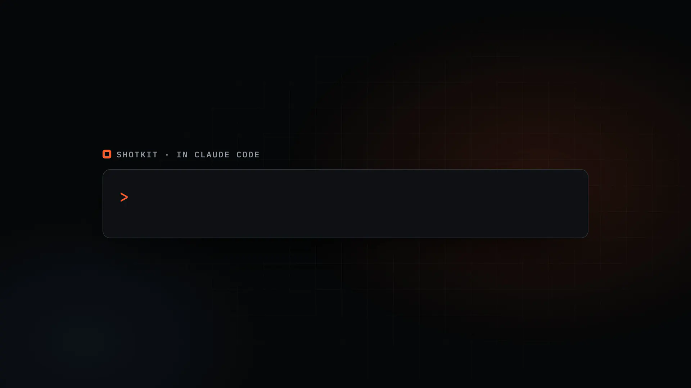
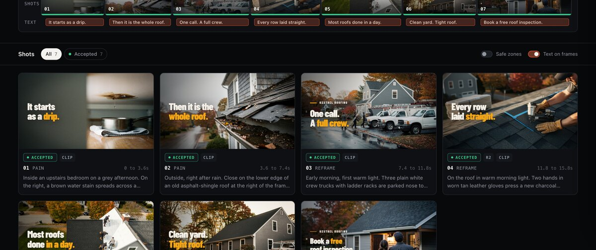
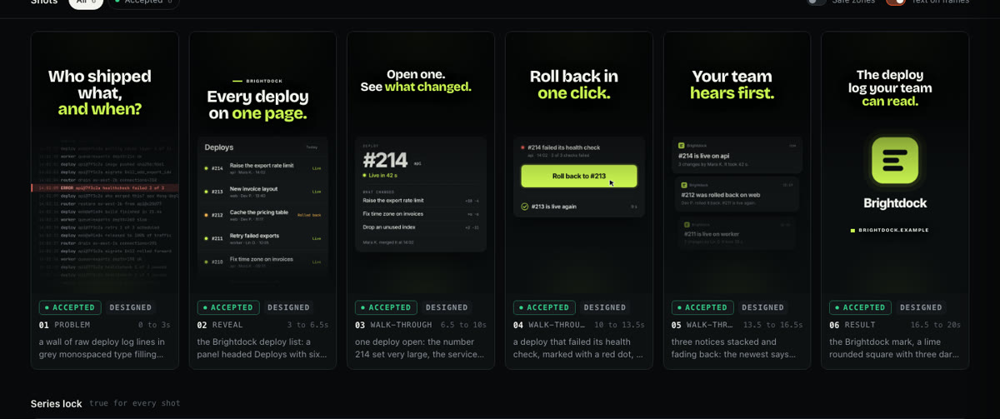

<h1 align="center">Shotkit</h1>

<p align="center"><strong>先把整支视频规划好，再去生成第一帧。</strong><br>
Claude Code 的 AI 分镜技能包。一句需求，或者一个装着你自己素材的文件夹，<br>
变成一块看板：每个镜头都已规划、写好提示词、并经过检查。</p>

<p align="center"><a href="README.md">English</a> · <strong>简体中文</strong></p>



三个已完成的案例，点击图片打开在线看板。

| Media Tsunami · 16:9 | 屋顶工程公司 · 16:9 | 软件发布 · 9:16 |
|---|---|---|
| [](https://whystrohm.com/shotkit/examples/whystrohm-media-tsunami/board.html) | [](https://whystrohm.com/shotkit/examples/kestrel-roofing/board.html) | [](examples/brightdock) |

六个 Claude 技能加一组小工具，由 [WhyStrohm](https://whystrohm.com) 开发。
Apache 2.0 开源，免费。仓库里不带任何密钥。

## 为什么需要它

图像和视频生成模型一次只出一个片段。一支 30 秒的视频是八个必须互相对得上的镜头：
同一个人、同一个场景、同一种光线、同一个品牌，文字还要放得进画面。
一个一个地写提示词，第五个镜头就和第二个对不上，品牌色会跑偏，
而且直到剪辑时才有人认真看每一帧。

Shotkit 做的是生成之前的那一步：

- **规划每个镜头**：时长、景别、运动和画面文字，按叙事框架排好。
- **锁定不能变的东西**：整支视频共用的人物、场景、光线和调色，以及品牌的颜色和字体。
- **为每个镜头写提示词**：支持十个图像和视频生成模型，各用各的格式。
- **检查每一帧**：对照镜头和品牌，指出要改什么，只重做那一个镜头。
- **优先用你自己的素材**：指向一个照片和视频的文件夹，它逐个查看、放到合适的镜头上，只把缺的部分留给生成模型。
- **全部放在一块看板上**：在浏览器里打开，每段内容都能一键复制给任何模型。

Shotkit 负责规划镜头，接入你自己的密钥后还能生成画面和片段。它不负责剪辑成片。

## 安装

在 Claude Code 里：

```
/plugin install shotkit --marketplace whystrohm/shotkit
```

然后输入需求：

```
/shotkit:shotkit 为我们的新应用做一支 30 秒的发布视频，9:16
```

需要 Claude Code 2.1.275 或更高版本。旧版本请先运行
`/plugin marketplace add whystrohm/shotkit`，再运行 `/plugin install shotkit@shotkit`。

也可以用安装脚本，这样可以用更短的 `/shotkit` 命令：

```bash
git clone https://github.com/whystrohm/shotkit.git
cd shotkit && ./install.sh
```

## 从你已有的素材开始

```
/shotkit:shotkit 用 ~/Desktop/shoot 里的照片和视频做一支 30 秒的视频，9:16
```

Claude 会查看每一张照片和每一段视频，把它们放到合适的镜头上，并标出缺少的部分。
生成模型只负责补缺；两个接不上的镜头之间，可以生成一段过渡片段。
你的原始文件不会被移动或修改。详见 [docs/own-media.md](docs/own-media.md)（英文）。

## 生成画面和视频片段

用你自己的 fal.ai 密钥，`sk generate` 可以生成静帧和视频片段并归档。
密钥只放在你的环境变量或被 git 忽略的 `.env` 文件里。
不加 `--yes` 不会发送任何请求。详见 [docs/generate-with-fal.md](docs/generate-with-fal.md)（英文）。

## 看板

一次运行对应一个页面：输出文件夹里的单个 HTML 文件，可以离线打开，不上传任何内容。

- **一眼看到所有镜头**：缩略图总览和时间线，镜头、屏幕文字、旁白各占一条轨道。
- **提示词带复制按钮**：每个生成模型一个标签页，按 `C` 复制当前这条。
- **每一帧的评审结论**：哪里可以、哪里不行、怎么改。之前几轮的结果也都留着。
- **实时模式**：`sk board output/ --serve` 会随文件变化自动刷新。把画面拖到镜头上即可保存；
  拖动镜头上的文字可以调整位置，文字不会超出安全区。
- **安全区**：一个开关，显示竖屏视频里会被应用界面挡住的区域。
- **给客户看的页面**：`preview.html` 是同一份计划的简洁版本，看板上的 **PDF** 按钮可直接打印。
- **导出**：`sk export output/` 生成带文字的轮播图片、一份 PowerPoint 和一个粗剪视频。见 [`docs/export.md`](docs/export.md)。

## 六个技能

| 技能 | 作用 |
|---|---|
| `shotkit` | 入口。一句需求，从计划做到看板 |
| `storyboard-architect` | 规划每个镜头，写出 `shots.json` |
| `visual-prompt-forge` | 为每个镜头、每个生成模型写提示词 |
| `visual-asset-critic` | 对照镜头和品牌检查每一帧 |
| `storyboard-html-preview` | 生成看板和客户预览页 |
| `brand-lock-extractor` | 从网站、PDF 或截图读出品牌的颜色、字体和语气 |

## 数据去哪了

Shotkit 没有服务器，也不需要账号。看板、检查和工具都在你的电脑上运行，不向外发送任何内容。
规划和评审由 Claude 完成，所以 Claude 会收到它读取的内容：你的需求、品牌资料，
以及它查看过的素材和画面的缩略图，与你平时使用 Claude 的条款相同。
只有当你用自己的密钥发起生成时，请求才会发送到 fal.ai。

## 人工确认

评审结论是模型给出的。有人确认之后，把这件事也记下来：

```bash
~/.claude/shotkit-tools/sk approve output/ --by "姓名"                 # 确认计划
~/.claude/shotkit-tools/sk approve output/ --by "姓名" --what frames   # 确认已通过的画面
```

每次确认都是 `output/approvals/` 里的一个新文件，用哈希记录确认的是哪一版。
之后内容有变，看板和 `sk validate` 会提示这次确认已失效。名字是手动输入的，
所以这是一条记录，不是签名。

## Shotkit 不做什么

Shotkit 给出的是计划和原始素材，不是成片。剪辑、文字排版、调色、声音、
各平台尺寸和发布不在其中。开发 Shotkit 的 WhyStrohm 把这部分作为付费服务提供：
[whystrohm.com](https://whystrohm.com)。

## 文档

完整文档为英文：[README](README.md) · [快速上手](https://whystrohm.com/shotkit/docs/quickstart) · [更新日志](CHANGELOG.md)

## 许可

Apache 2.0。见 [LICENSE](LICENSE)。
