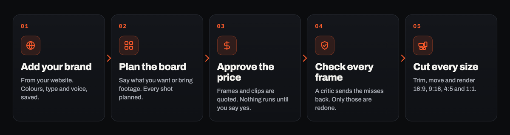
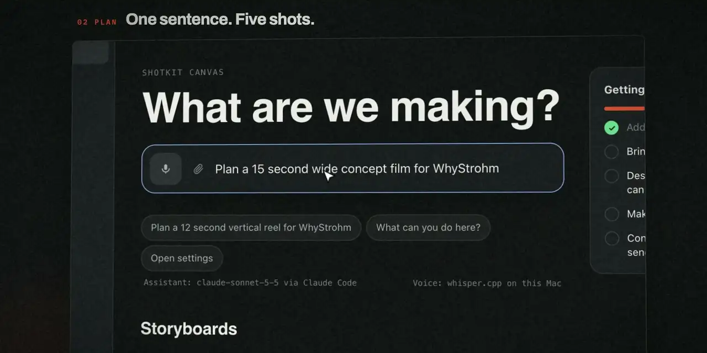
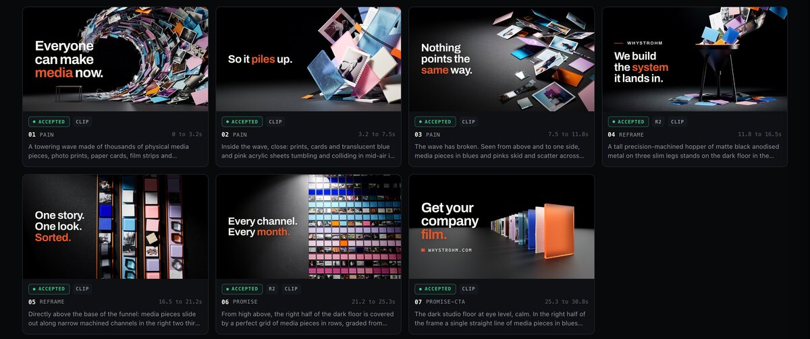

<p align="center"><a href="https://whystrohm.com/blog/shotkit-canvas-one-real-run"><picture><source media="(max-width: 700px)" srcset="docs/images/demo-phone.webp"></picture></a></p>

<h3 align="center">批量交付符合品牌的视频。</h3>

<p align="center">在看板上规划每个镜头，检查每一帧，渲染每种尺寸。<br>
用你自己的素材，或在有用的地方用 AI。每个报价都等你确认。<br>
它在你自己的 Mac 上运行，配合 Claude Code 或 Codex，用你自己的密钥。</p>

<p align="center"><a href="README.md">English</a> · <strong>简体中文</strong></p>

<p align="center"><a href="https://whystrohm.com/shotkit"><strong>完整介绍</strong></a> · <a href="https://github.com/whystrohm/shotkit/releases">下载 Canvas</a></p>

<p align="center"><strong>3.7 新增：Shotkit Canvas。</strong>每个片段都在看板上播放，镜头可以移动和修剪，<br>
一个剪辑输出所有尺寸。免费开源。<a href="https://github.com/whystrohm/shotkit/releases">下载</a></p>

## 两种用法

| | **插件** · 在 Claude Code 中 | **Canvas** · Mac 应用 |
|---|---|---|
| **适合** | 把一句简报和你的照片变成可以分享的清晰计划 | 在一个地方规划、检查并剪辑视频 |
| **你会得到** | 分镜页面、可打印成 PDF 的客户页面、PowerPoint、静帧和粗剪 | 插件的全部计划，加上聊天、先确认的报价、在看板上播放的片段，以及每种尺寸的剪辑 |
| **开始** | `/plugin install shotkit --marketplace whystrohm/shotkit` · [步骤](#安装) | 从 [Releases](https://github.com/whystrohm/shotkit/releases) 下载，运行 `./start.sh --open` · [步骤](#试用-canvas) |





两个真实的 WhyStrohm 案例，点击图片打开在线看板。

| How we work · 在 Canvas 中完成 · 16:9 | Media Tsunami · 16:9 |
|---|---|
| [](https://whystrohm.com/shotkit/examples/whystrohm-how-we-work/board.html) | [](https://whystrohm.com/shotkit/examples/whystrohm-media-tsunami/board.html) |

六个 Claude 技能加一组小工具，由 [WhyStrohm](https://whystrohm.com) 开发。
Apache 2.0 开源，免费。仓库里不带任何密钥。

## 为什么需要它

生成一个片段已经很容易，难的是交付五十个看起来属于同一个品牌的视频。一支视频里的每个镜头都必须互相对得上：
同一个人、同一个场景、同一种光线、同一个品牌，文字还要放得进画面。
一个一个地写提示词，第五个镜头就和第二个对不上，品牌色会跑偏，
而且直到剪辑时才有人认真看每一帧。

Shotkit 负责规划、检查和剪辑：

- **规划每个镜头**：时长、景别、运动和画面文字，按叙事框架排好。
- **锁定不能变的东西**：整支视频共用的人物、场景、光线和调色，以及品牌的颜色和字体。
- **为每个镜头写提示词**：支持十个图像和视频生成模型，各用各的格式。
- **检查每一帧**：对照镜头和品牌，指出要改什么，只重做那一个镜头。
- **记住你的喜好**：对片段、字幕或渲染点喜欢或不喜欢并写明原因，Canvas 会把它存成这个品牌的偏好，你可以查看和修改，下次聊天会照着做。不会用你的文件训练模型。
- **优先用你自己的素材**：指向一个照片和视频的文件夹，它逐个查看、放到合适的镜头上，只把缺的部分留给生成模型。
- **全部放在一块看板上**：在浏览器里打开，每段内容都能一键复制给任何模型。
- **交给剪辑师**：把剪辑导出为 Premiere 或 Resolve 可用的剪辑决策表（CMX 3600），画面文字导出为带时间的字幕，再加一份给拍摄团队的镜头表。见[导出](docs/export.md)。
- **为智能体而建**：Claude Code 规划镜头，独立的审查者检查每一帧。Codex 可以读取 Canvas 看板并做可撤销的修改。每一笔花费都等你确认。

Shotkit 插件负责规划镜头、检查画面并生成粗剪。Canvas 支持在本机审阅、调整镜头与准备交接文件。

## 试用 Canvas

可以先看[一次真实运行](https://whystrohm.com/blog/shotkit-canvas-one-real-run)和[它的看板](https://whystrohm.com/shotkit/examples/whystrohm-how-we-work/board.html)。

在已发布的 Canvas 预览版 **Assets** 中下载 `shotkit-canvas-*.zip` 和对应的校验文件。
GitHub 的 **Source code** 压缩包包含插件与 CLI。 [GitHub Releases](https://github.com/whystrohm/shotkit/releases)

把这两个文件放在单独的文件夹，在该目录校验、解压并启动。macOS 需要 Python 3.10 或更高版本。

```sh
shasum -a 256 -c shotkit-canvas-*.zip.sha256 &&
unzip shotkit-canvas-*.zip &&
cd shotkit-canvas &&
./start.sh --isolated --open --port 0
```

在主页打开 **WhyStrohm · How it works**，可以播放影片、比较横版与信息流版，
也可以在画面上添加批注。**The flight of Apollo 11** 展示长片的章节导航。

如需连接 Claude，运行 `./start.sh --open`，进入 **Settings and keys → Claude**，
粘贴 API 密钥并选择 **Save and check**。密钥保存在 macOS 钥匙串中。
[Claude Console](https://platform.claude.com/settings/keys)

连接后，在 Home 选择 **Add a brand** 并输入网站，Canvas 会保存该网站显示的颜色、字体和文案规则。
然后在聊天中用一句话描述影片，Claude 会规划镜头并打开分镜。规划不会生成任何素材。

### 在 Canvas 中生成画面和片段

生成还需要已登录的 Claude Code、这个仓库的克隆，以及在 **Settings and keys** 中保存的
[fal.ai](https://fal.ai) 密钥。用下面的方式启动 Canvas，并在这个模式下规划影片：

```sh
SHOTKIT_HOME=/path/to/shotkit SHOTKIT_CANVAS_DATA="$HOME/.shotkit/canvas" python3 serve.py --open
```

Claude Code 负责写提示词、运行评审和写修改，Shotkit 的工具负责报价并生成画面和片段。
每个报价都要等你确认。只用下载包里的 `start.sh` 时，评审和修改不会运行。

### 长录像

从带时间码的字幕（SRT 文件）开始一个分镜，并添加 MP4 录像。Canvas 会按时间码把它分成章节和镜头，
逐段播放，并直接从录像中剪出任意一章。也可以从脚本开始，每行一个镜头。

Codex 可以通过 MCP 连接本机工作区。 [Codex 设置](README.md#use-canvas-from-codex)

## 安装

在 Claude Code 里：

```
/plugin install shotkit --marketplace whystrohm/shotkit
```

然后输入需求：

```
/shotkit:shotkit 为我们的新应用做一支 30 秒的发布视频，9:16
```

需要 Claude Code 2.1.275 或更高版本。旧版本请先运行
`/plugin marketplace add whystrohm/shotkit`，再运行 `/plugin install shotkit@shotkit`。

也可以用安装脚本，这样可以用更短的 `/shotkit` 命令：

```bash
git clone https://github.com/whystrohm/shotkit.git
cd shotkit && ./install.sh
```

### 在 Canvas 中打开项目

安装支持工作区 API 1 的 Shotkit Canvas 后，可通过 CLI 打开项目。
从仓库运行时使用 `tools/sk`。运行 `./install.sh` 后，使用以下路径。

```bash
~/.claude/shotkit-tools/sk workspace "/path/to/project" \
  --runtime "/path/to/shotkit-canvas" --open
```

项目目录和它的 `output/` 目录指向同一次工作记录。设置
`SHOTKIT_CANVAS_HOME` 后可省略 `--runtime`。`--rules-only`
可在无需连接 AI 的情况下审阅。`--port 0` 会选择可用的本地端口。
`--isolated` 跳过对其他项目和已保存密钥的查找。
插件自带的便携看板仍可通过 `sk board output/ --open` 打开。

Python 3.10 或更高版本可打开主页、分镜和已经完成的示例影片。
如需预览可编辑剪辑，请在 Canvas 目录运行
`npm ci` 和 `npm run build`，然后重启 Canvas。剪辑由 [Remotion](https://www.remotion.dev) 渲染；
如果为公司渲染，请查看 [Remotion 的许可](https://www.remotion.dev/license)。

## 从你已有的素材开始

```
/shotkit:shotkit 用 ~/Desktop/shoot 里的照片和视频做一支 30 秒的视频，9:16
```

Claude 会查看每一张照片和每一段视频，把它们放到合适的镜头上，并标出缺少的部分。
生成模型只负责补缺；两个接不上的镜头之间，可以生成一段过渡片段。
你的原始文件不会被移动或修改。详见 [docs/own-media.md](docs/own-media.md)（英文）。

## 生成画面和视频片段

用你自己的 fal.ai 密钥，`sk generate` 可以生成静帧和视频片段并归档。
密钥只放在你的环境变量或被 git 忽略的 `.env` 文件里。
不加 `--yes` 不会发送任何请求。详见 [docs/generate-with-fal.md](docs/generate-with-fal.md)（英文）。

## 看板

一次运行对应一个页面：输出文件夹里的单个 HTML 文件，可以离线打开，不上传任何内容。

- **一眼看到所有镜头**：缩略图总览和时间线，镜头、屏幕文字、旁白各占一条轨道。
- **提示词带复制按钮**：每个生成模型一个标签页，按 `C` 复制当前这条。
- **每一帧的评审结论**：哪里可以、哪里不行、怎么改。之前几轮的结果也都留着。
- **实时模式**：`sk board output/ --serve` 会随文件变化自动刷新。把画面拖到镜头上即可保存；
  拖动镜头上的文字可以调整位置，文字不会超出安全区。
- **安全区**：一个开关，显示竖屏视频里会被应用界面挡住的区域。
- **给客户看的页面**：`preview.html` 是同一份计划的简洁版本，看板上的 **PDF** 按钮可直接打印。
- **导出**：`sk export output/` 生成带文字的轮播图片、一份 PowerPoint 和一个粗剪视频。见 [`docs/export.md`](docs/export.md)。

## 六个技能

| 技能 | 作用 |
|---|---|
| `shotkit` | 入口。一句需求，从计划做到看板 |
| `storyboard-architect` | 规划每个镜头，写出 `shots.json` |
| `visual-prompt-forge` | 为每个镜头、每个生成模型写提示词 |
| `visual-asset-critic` | 对照镜头和品牌检查每一帧 |
| `storyboard-html-preview` | 生成看板和客户预览页 |
| `brand-lock-extractor` | 从网站、PDF 或截图读出品牌的颜色、字体和语气 |

## 数据去哪了

便携看板和检查在电脑本地运行。Canvas 的服务仅监听本机。
使用 Claude Code 规划和评审时，Claude 会收到读取的需求、品牌资料和素材。
连接 Claude Console 后，Canvas 聊天会发送请求和相关项目内容。
使用 fal.ai 生成素材需要使用自己的密钥，报价查询和你确认的生成任务会发到 fal.ai。
**Add a brand** 会读取你输入的网站页面。看板联网打开时会加载 Google Fonts。
只有你选择发送的内容才会发到 GoHighLevel。 [安全与数据](SECURITY.md)

## 人工确认

评审结论是模型给出的。有人确认之后，把这件事也记下来：

```bash
~/.claude/shotkit-tools/sk approve output/ --by "姓名"                 # 确认计划
~/.claude/shotkit-tools/sk approve output/ --by "姓名" --what frames   # 确认已通过的画面
```

每次确认都是 `output/approvals/` 里的一个新文件，用哈希记录确认的是哪一版。
之后内容有变，看板和 `sk validate` 会提示这次确认已失效。名字是手动输入的，
所以这是一条记录，不是签名。

## 输出

便携看板可以导出镜头表、幻灯片和粗剪。Canvas 可以移动镜头、修剪片段、修改台词，
以 16:9、9:16、4:5 和 1:1 输出剪辑，并将带时间信息的镜头表和字幕交给剪辑师。 [导出](docs/export.md)

## 文档

完整文档为英文：[README](README.md) · [快速上手](https://whystrohm.com/shotkit/docs/quickstart) · [更新日志](CHANGELOG.md)

## 交给我们

Shotkit 免费。它是 WhyStrohm 在一台 Mac Studio 上运行的整套系统中的一部分。如果你想把整套系统用在你的品牌上，我们可以帮你搭建并运行：品牌、素材库和模板，
每种尺寸的成片，以及每月发布。[联系我们](https://whystrohm.com/apply)。

## 反馈

告诉我们哪里出了问题，或者你接下来想要什么。
[提交 issue](https://github.com/whystrohm/shotkit/issues)、
[发起讨论](https://github.com/whystrohm/shotkit/discussions)，或写信到
[hello@whystrohm.com](mailto:hello@whystrohm.com)。

## 许可

Apache 2.0。见 [LICENSE](LICENSE)。

## 开发者

Shotkit 由 WhyStrohm 的 Yuri Strohm 创建和维护。OpenAI Codex 和 Anthropic
Claude 协助实现与审查。
