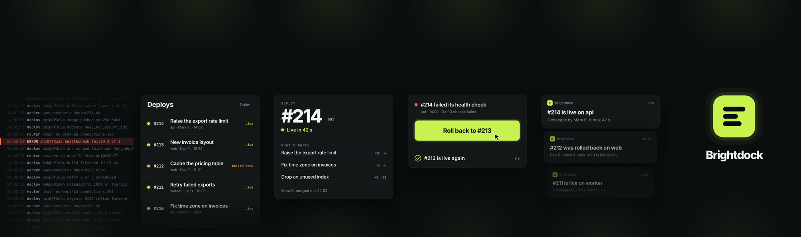

# Designed frames: pictures drawn in code from your brand

An image generator is the wrong tool for a screen of your product, a number, a quote or
a logo card. It cannot spell and it has never seen your app. For those shots Shotkit
draws the frame itself, in code, from the brand lock.



*The bundled example. Every frame above was drawn by `sk design`. Brightdock is not a real product.*

## What "designed" means

- **No model is involved.** A page in a browser with no window draws the panel.
- **It is your brand.** The ground, the type colour, the accent, the borders and the body
  typeface come from the brand lock. Change the lock and every frame follows.
- **It is the same every time.** On one computer, the same card, brand lock and Shotkit
  version draw the same picture, pixel for pixel. `sk design output/ --check` draws them
  again and says if one changed. Another operating system can set type a pixel
  differently, so run the check on the computer that drew them.
- **The words are yours.** Text in a card is set as type, so it is spelled the way you
  wrote it.
- **The panel makes room.** It sits where the shot's on-screen text is not.

## The short way

Ask for it in the brief:

```
/shotkit:shotkit 20-second launch video for our deploy log, 9:16. Draw the product screens, do not generate them.
```

Claude plans the shots, writes one card for each screen, and runs `sk design`. Then say
what to change: "make the second row the one that failed", "use our real numbers".

## By hand

A shot asks for a designed frame in `shots.json`:

```json
"source": {"type": "design", "card": "list"}
```

The card is in `output/design/cards.json`, under the shot's id:

```json
{
  "version": "1.0",
  "cards": {
    "shot_02": {
      "kind": "list",
      "title": "Deploys",
      "tag": "Today",
      "rows": [
        {"key": "#214", "title": "Raise the export rate limit", "sub": "api · Mara K. · 14:02", "status": "Live"},
        {"key": "#212", "title": "Cache the pricing table", "sub": "web · Dev P. · 11:17", "status": "Rolled back", "tone": "warn"}
      ]
    }
  }
}
```

Draw them:

```bash
sk design output/            # writes frames/round-1/shot_02.png and design/receipt.json
sk design output/ --check    # draws again and compares with the receipt
sk design --kinds            # every kind of card and what it takes
```

## The kinds of card

| Kind | What it draws | Needs |
|---|---|---|
| `lines` | A wall of monospaced lines, one of them flagged. Logs, code, raw data. | `lines` |
| `list` | A titled panel of rows: a key, a line, a small line, a status. | `title`, `rows` |
| `detail` | One thing open: a very large value, a status, a few rows. | `big` |
| `action` | A problem, the button that fixes it, and the result. | `alert`, `button` |
| `notices` | Up to three notices stacked, the newest in front. | `items` |
| `mark` | The brand's mark and name, alone. | nothing |
| `stat` | One number, very large, and the line that explains it. | `value` |
| `quote` | One quotation and who said it. | `text` |

A row or a status can carry a `tone`: `good` (the brand's accent), `warn` (amber) or `bad`
(red). Amber and red are status colours inside the panel. They are not brand colours and
are never used for on-screen text.

## What it is not

- **Not a screenshot.** A designed frame shows what you typed into the card. Do not put a
  number, a customer or a feature in a card that is not true of your product.
- **Not your interface, pixel for pixel.** It is a clean panel in your brand. For the real
  thing, use your own screenshots: [Start from your own photos and clips](own-media.md).
- **Not for people, places or products on a table.** Those are for a camera or a
  generator.
- **Built for vertical video first.** On a wide frame the panel takes one side.

## The check still runs

A designed frame is reviewed like any other: against the shot and the brand. Its critique
names `design/cards.json` as what the frame was made from, by hash, so a card changed
after the review shows up as a changed file.

Needs Chrome, Edge, Brave or Chromium. The brand's typeface is fetched from Google Fonts
on the first draw and kept in `design/fonts.css`, so later draws use the same font files
and need no connection. With no connection on the first draw, the frames are set in a
system font and the tool says so.
