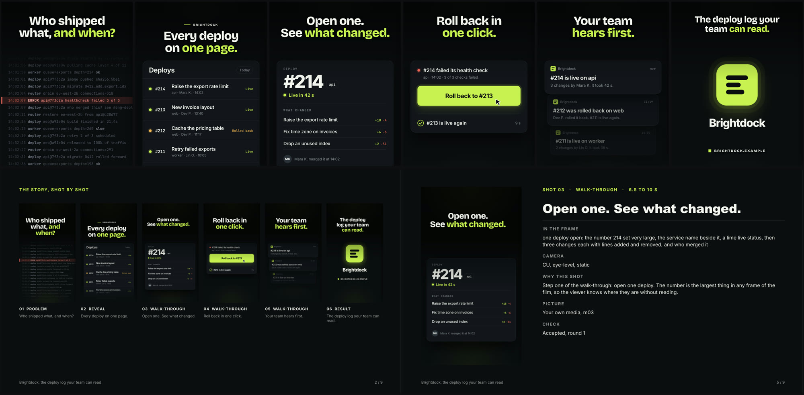

# Export: stills, a deck and a rough cut

A finished board is a plan. Export turns it into files you can use the same day: stills
to post, a deck to present, a rough cut to play, and the lists a crew and an editor work
from.



*From the bundled example. Brightdock is not a real product.*

## The short way

On a live board, press **Export** and then **Make**. The file downloads and is also saved
in `output/export/`.

```bash
~/.claude/shotkit-tools/sk board output/ --serve --open
```

Or ask Claude: "export the stills", "export the deck", "export the rough cut".

Or run it yourself:

```bash
sk export output/                 # everything this computer can make
sk export output/ stills          # only the stills
sk export output/ deck            # only the deck
sk export output/ cut --music track.wav
sk export output/ edit            # the shoot and edit files
```

## What you get

| File | What it is | What it needs |
|---|---|---|
| `export/stills-9x16/shot_01.png` and so on, plus `export/stills.zip` | One image per shot with its on-screen text on it. A tall plan also gets a 4:5 set, which is the size a feed carousel uses. | Chrome, Edge, Brave or Chromium |
| `export/storyboard.pptx` | A deck: a title slide, the whole story on one slide, one slide per shot, and the brand lock. The words are real text you can edit. It opens in PowerPoint, Keynote and Google Slides. | Nothing. With a browser the pictures carry the on-screen text. |
| `export/rough-cut.mp4` | The shots in order as one video. Each runs for its planned length, and the text comes in and out at its planned times. | `ffmpeg`, and a browser for the text |

The deck works on a plan with no frames at all. Each slide then shows the planned text on
the brand's ground, so you can present a concept before anything is generated.

Not sure what this computer can make? `sk doctor` says whether it found a browser and
`ffmpeg`.

## For the crew and the editor

`sk export output/ edit` writes three plain files to `export/edit/`, and `export/edit.zip`:

| File | Who it is for | What is in it |
|---|---|---|
| `shot-list.csv` | Whoever shoots it | One row per shot in a crew's words: close-up, eye level, push in, shallow focus. In and out as timecode, what we see, the line on screen, the voice, the sound. |
| `text.srt` | The editor | Every on-screen line at its planned time, as subtitles. Import it into Premiere, Resolve, Final Cut or CapCut and the text track is already timed. |
| `cut.edl` | The editor | The cut as an edit decision list (CMX 3600), one event per shot, 30 frames a second, starting at 01:00:00:00. Relink it to the frames and clips and the timeline is laid out. |

The plan stores a shot as `CU`, `eye-level`, `push`. The shot list spells those out,
because a crew reads "Close-up, eye level, push in" and an editor reads timecode.

Pick other sizes with `--size`: `9x16`, `4x5`, `1x1`, `16x9`, `3x4`, `2x3`. A size that is
not the plan's own is cropped from the centre of the frame, so check that nothing
important sits at the edge.

## How the text is drawn

The board's own page draws each still. The export tool opens that page in a browser
with no window and photographs one shot at the exact pixel size. A still, a slide and
the rough cut therefore carry the type you see on the board: the same font, size,
emphasis and position. Move a line on a live board and the next export moves with it.

The brand's typefaces load from Google Fonts, so the first export needs a connection.
Offline, type falls back to your system fonts.

## What a rough cut is, and is not

It is a file you can play, send and judge the pacing from. It is made with hard cuts.

- A shot with a clip plays the clip, cut to the shot's length.
- A shot with only a frame holds the frame. There is no motion on stills.
- Clip sound is left out. `--music` lays one track under the whole cut and fades it out.
- A shot with no frame yet is left out, and the report names it.

For the finished video, take the clips, `shots.json` and `text-overlays.json` into your
editor. See [Connecting to video pipelines](connecting-to-video-pipelines.md).

## What it does not do

- It does not change anything outside `output/export/`. The pinned plan stays as it was.
- It does not send anything anywhere. The browser and `ffmpeg` run on your computer.
- It does not add a Shotkit line to your files.
