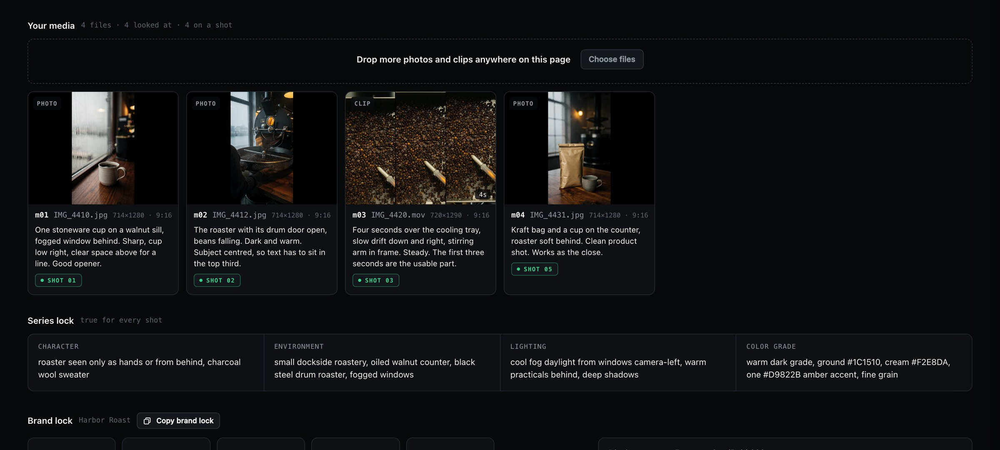
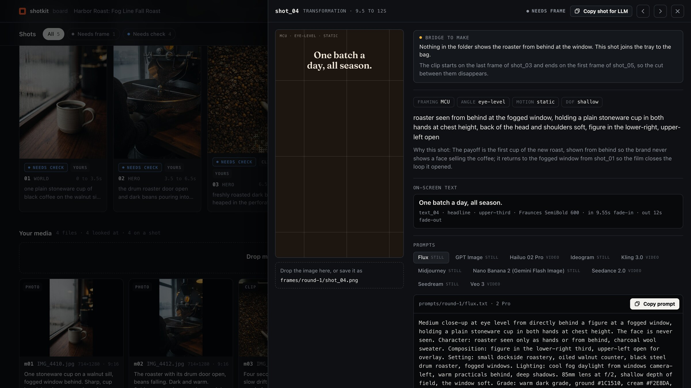

# Start from your own photos and clips

Shotkit can plan a video around footage you already have. Claude looks at every file,
puts each one on the shot it fits, and tells you what is missing. A generator fills
only the gaps.



*Shown with sample files from the Harbor Roast example.*

## The short way

In Claude Code:

```
/shotkit a 30-second video from the photos and clips in ~/Desktop/shoot, 9:16
```

A board opens with your media on the shots, and a list of anything the story still needs.

## The upload page

No folder ready? Start an empty live board and drop files on it:

```bash
~/.claude/shotkit-tools/sk board output/ --serve --open
```

Drop photos and clips anywhere on the page, or use **Choose files**. They are saved to
`output/media/inbox/` and listed under **Your media**. Nothing is uploaded to a server:
the page talks only to your own computer. Then tell Claude:

```
/shotkit plan a 30-second video from the media in output/, 9:16
```

## What happens

| Step | What Shotkit does | Command |
|---|---|---|
| 1. List | Finds every photo and clip in the folder. Makes a thumbnail of each. A clip gets its first, middle and last frame. | `sk media scan <folder> --out output/` |
| 2. Look | Claude opens every thumbnail and writes what is in it: the subject, where it sits, what is usable. | |
| 3. Plan | The storyboard is built around what you have. Each file goes on the shot it fits. Weak files are left out. | |
| 4. Gaps | A shot the story needs and the folder lacks is marked **To make**, with the reason. | |
| 5. Bridges | Two of your shots that do not cut together get a short generated clip between them. | |
| 6. Place | Each file is copied to its shot, so the board, the checks and the handoff all see it. | `sk media place output/` |
| 7. Fill | You shoot the gaps, make them in your own generator, or let Shotkit make them on fal.ai. | `sk generate output/ --model flux` |

Your originals are never moved, renamed or changed. Shotkit works on copies inside
`output/`.

## What it reads

- **Photos:** PNG, JPEG, WebP, HEIC, TIFF. HEIC and TIFF are converted to JPEG when
  placed, which needs `ffmpeg`, or `sips` on a Mac.
- **Clips:** MP4, MOV, M4V, WebM. Reading a clip's length and frames needs `ffmpeg` and
  `ffprobe`. Without them photos still work and clips are listed by name and size.

## On the board

- **Your media** shows every file, what Claude saw in it, and the shot it is on. A file
  that was not used is dimmed and marked **Not used**.
- A shot on your own media carries a **Yours** tag. A gap carries **To make**. A bridge
  carries **Bridge**.
- A clip plays only the seconds the shot uses.
- The next step reads **Fill the gaps** once your media is placed.

## Gaps and bridges

A gap is an ordinary shot with a prompt. Fill it any way you like.

A bridge is a clip that starts on the last frame of one shot and ends on the first frame
of the next, so the cut between them disappears. It needs a video model that takes an
end frame. On fal.ai, Kling, Seedance and Hailuo do. See
[Generate with fal.ai](generate-with-fal.md) for the key and the cost rule: nothing is
sent without `--yes`, and fal bills your account.

```bash
sk generate output/ --model kling          # shows what it would send, spends nothing
sk generate output/ --model kling --yes    # sends it
```

Shots on your own media are skipped. Shotkit never regenerates a picture you supplied.



## The check still runs

Your photos are checked the same way generated frames are: against the shot and the
brand. A frame that is soft, off brand or leaves no room for the text comes back with
what to fix, which for your own footage usually means a different take or a crop.

## The files

```
output/
  media/
    media.json        every file: id, size, length, what Claude saw, which shot
    thumbs/           what Claude looks at
    inbox/            files dropped on the live board
    ends/             the last frame of each placed clip, for bridges
  shots.json          each shot's "source": own, or generate
  frames/round-1/     your photos, and the first frame of each clip
  clips/round-1/      your clips
```
